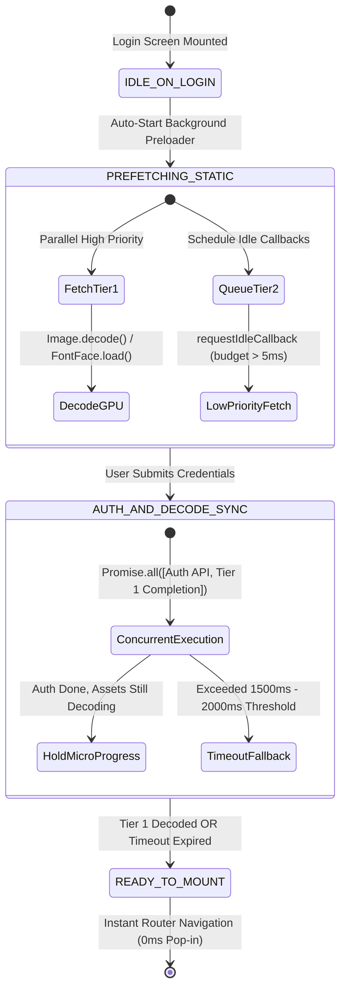

# UI Design System & Color Tokens (Graphify Edition)

This design specification outlines the typography, tokens, contrast ratios, and UI component patterns derived from the two high-impact color duos for **Graphify**:
1. **Midnight Plum & Honey Dawn** (`#3B163A` + `#F0C986`) — Warm, Editorial, Premium Museum Luxury
2. **Neon Lime & Royal Blue** (`#D9FF3A` + `#0245EC`) — High-Energy, Neo-Brutalist, Electric Tech

---

## 1. Palette Overview & Color Specifications

### Palette A: Midnight Plum & Honey Dawn (Editorial Luxury)
| Token Name | Hex Code | RGB | Suggested Role | Contrast / Usage Note |
| :--- | :--- | :--- | :--- | :--- |
| `color-plum-primary` | `#3B163A` | `rgb(59, 22, 58)` | Primary surface, deep header, canvas background | Rich deep plum; pairs with white or Honey Dawn |
| `color-plum-dark` | `#240C23` | `rgb(36, 12, 35)` | Canvas background, deep backdrop | Ultimate deep plum darkness |
| `color-plum-light` | `#532152` | `rgb(83, 33, 82)` | Hover state, card borders | Subtle lift on dark plum |
| `color-honey-accent` | `#F0C986` | `rgb(240, 201, 134)` | Accent fill, callout pill, active node aura | Warm golden dawn; high contrast against `#3B163A` |
| `color-honey-light` | `#FCEFD5` | `rgb(252, 239, 213)` | Badge text, highlighted labels | Soft warm cream |
| `color-honey-dark` | `#D8AE64` | `rgb(216, 174, 100)` | Secondary pill border, dimmed links | Deep gold |

### Palette B: Neon Lime & Royal Blue (Neo-Brutalist Electric)
| Token Name | Hex Code | RGB | Suggested Role | Contrast / Usage Note |
| :--- | :--- | :--- | :--- | :--- |
| `color-lime-primary` | `#D9FF3A` | `rgb(217, 255, 58)` | High-visibility CTA, badge, active node highlight | Ultra-bright electric lime; requires black text |
| `color-lime-light` | `#EEFF82` | `rgb(238, 255, 130)` | Secondary glow, active pill fill | Glowing electric lime |
| `color-blue-primary` | `#0245EC` | `rgb(2, 69, 236)` | Electric surface, primary action, brand blue | Saturated vivid royal blue; pairs with pure white |
| `color-blue-dark` | `#012FB0` | `rgb(1, 47, 176)` | Dark container background, edge links | Deep electric royal |

---

## 2. Typography & Form Language

### Typography
- **Display & Headings:** Ultra-bold / Black grotesque sans-serif (`Syne`, `Clash Display`, `Space Grotesk`, `Inter Black`).
  - Letter spacing: `-0.04em` (tight tracking).
  - Text transformation: `UPPERCASE` for punchy titles and card headers.
- **Body & Captions:** Clean neutral sans-serif (`Inter`, `Plus Jakarta Sans`).
- **Code & Hex Values:** Monospace (`JetBrains Mono`).

### Form Language & Pill Badges
- **Card Corners:** Smooth rounded cards (`border-radius: 28px`).
- **Data/Code Badges:** Floating pill shape (`border-radius: 9999px`), centered or alongside headlines.
- **Swatch Card Aesthetic:** Bold background, uppercase title, floating high-contrast pill badge with subtle hover scale.

---

## 3. Zero-Lag Login & Background Asset Preloading Architecture

### 3.1 Overview & System Objective
In rich web applications featuring high-fidelity 3D WebGL canvases, custom typography, audio soundscapes, and heavy imagery, standard post-login navigation typically triggers an avalanche of synchronous network requests, font swapping (FOUT/FOIT), and on-thread image rasterization. This results in observable UI jank, frame drops (dipping below 30fps), Cumulative Layout Shift (CLS), and noticeable white flashes or empty skeletons.

The **Zero-Lag Login & Background Asset Preloading Architecture** leverages the user's dwell time during the authentication flow (reading the prompt, entering credentials, resolving MFA) to pre-warm the browser's Cache Storage, HTTP disk cache, and GPU texture memory. By synchronizing the authentication completion with a non-blocking Tier 1 asset gate and decoupling Tier 2 assets onto idle execution threads, post-login dashboard rendering occurs in **0ms with zero layout shifts and a locked 60fps frame rate**.

---

### 3.2 Performance Goals & Core Web Vitals Targets

| Metric / Experience Target | Standard Route Change | Zero-Lag Preloaded Target | Verification Mechanism |
| :--- | :--- | :--- | :--- |
| **Animation Frame Rate** | 24 - 45 fps (stutters on decode) | **Locked 60.0 fps (16.6ms frame budget)** | Chrome Performance profiler / DevTools FPS meter |
| **Post-Login Asset Pop-In** | 350ms - 1200ms latency | **0ms (Immediate render from GPU memory)** | LCP timestamp vs. DOMContentLoaded event delta |
| **Cumulative Layout Shift (CLS)** | 0.12 - 0.28 (Font FOUT / unsized images) | **0.000 (Zero layout displacement)** | PerformanceObserver layout-shift metric |
| **Input Latency During Typing** | 45ms - 90ms (blocked main thread) | **< 16ms (Instantaneous keystroke response)** | INP (Interaction to Next Paint) auditing |
| **Network Redundancy** | Cache misses / duplicate requests | **100% Cache API / HTTP Cache hit rate** | Service Worker fetch intercept inspection |

---

### 3.3 Preloading Lifecycle State Machine

The preloader operates as a deterministic, finite state machine (FSM) synchronized with the user interaction and authentication lifecycle:



#### Detailed State Specifications:
1. **`IDLE_ON_LOGIN`**:
   - Initial state when the login route mounts.
   - Allocates the singleton `AssetPreloaderEngine` instance.
   - Reads device memory (`navigator.deviceMemory`) and network conditions (`navigator.connection.effectiveType`) to calibrate concurrency thresholds.

2. **`PREFETCHING_STATIC`**:
   - Triggered immediately as the user focuses input fields or views the entrance cinematic.
   - Spawns parallel network fetches for **Tier 1 (Critical)** assets.
   - Pushes **Tier 2 (High / Background)** assets into an idle work queue processed exclusively during `requestIdleCallback` windows, guaranteeing the main thread remains 100% idle for 60fps input typing and paper physics animations.

3. **`AUTH_AND_DECODE_SYNC`**:
   - Triggered upon form submission (`Sign In`, `1-Click VIP`, or `Guest Admission`).
   - Executes `Promise.all([authPromise, preloader.waitForTier1(maxHoldMs)])`.
   - If the authentication API responds before Tier 1 assets finish decoding, the UI displays a brutalist micro-progress bar and indicator (e.g. `[ SYNCHRONIZING SECURE SESSION & GPU TEXTURES... ]`) for a maximum bounded duration.

4. **`READY_TO_MOUNT`**:
   - Both authentication credentials and critical visual/structural textures have been validated and rasterized.
   - Navigates immediately to the destination route (`/` or `/museum`) with zero wait time.

---

### 3.4 Tiered Asset Priority Queue Specification

Assets are partitioned into strict priority classes to prevent bandwidth starvation on low-tier connections:

```
┌────────────────────────────────────────────────────────────────────────┐
│                        TIERED ASSET QUEUE                              │
├────────────────────────────────────────────────────────────────────────┤
│ TIER 1: CRITICAL (Blocks Navigation Gate, Max Concurrency: 6)          │
│ • Next.js Route Bundles: Router Prefetch for `/` and `/museum`         │
│ • Primary Web Fonts: Space Grotesk Bold, Space Mono Regular            │
│ • Core SVG UI Sprites: Globe, Window, File, Archival Badges            │
│ • Above-the-Fold Hero Visuals: Symphony Portal Arch, Main Canvas Mesh  │
├────────────────────────────────────────────────────────────────────────┤
│ TIER 2: HIGH / BACKGROUND (Non-Blocking, requestIdleCallback Budget)   │
│ • Secondary Route Chunks: `/evolution`, `/compare`, `/hall`            │
│ • Heavy Audio Tracks: Ambient Spaceship Soundscape, Deep Tones         │
│ • Heavy 3D GLTF Specimen Models: Ammonite, Archaeopteryx               │
│ • Below-the-Fold Image Galleries and Procedural Texture Maps           │
└────────────────────────────────────────────────────────────────────────┘
```

---

### 3.5 Asset Caching & GPU Decoding Strategy

#### 1. Hardware GPU Texture Decompression (`Image.decode()`)
Standard browsers perform image rasterization and decompression lazily on the main thread when an image element is first appended to the DOM. For multi-megabyte hero banners and WebGL texture maps, this causes noticeable main-thread freezes (up to 120ms frame drops).

To eliminate this:
```typescript
const img = new Image();
img.crossOrigin = 'anonymous';
img.src = assetUrl;

// Preload into memory and force decompression directly in GPU texture memory
await img.decode();
hotTextureStore.set(assetUrl, img);
```
By retaining the decoded `HTMLImageElement` in an in-memory `Map` until navigation completes, the browser reuses the hot GPU texture without re-decoding.

#### 2. Cache API & Persistent Service Worker Storage
To guarantee persistent instant loads across tab reloads:
- The engine opens `caches.open('museo-preloaded-v1')`.
- Assets are queried and populated using `cache.add(url)` concurrently with HTTP header validation.
- Subsequent fetches hit the browser Cache Storage in 0ms without hitting the server.

#### 3. Font Face Loading via CSS Font Loading API
Fonts loaded via `@font-face` can trigger Flash of Invisible Text (FOIT) or Flash of Unstyled Text (FOUT), which directly inflates CLS.
The preloader forces explicit font compilation:
```typescript
if ('fonts' in document) {
  await document.fonts.load('700 1rem Space Grotesk');
  await document.fonts.load('400 1rem Space Mono');
}
```
Navigation does not trigger until `document.fonts.load()` resolves, ensuring 0.000 CLS on target pages.

#### 4. Dynamic `<link rel="preload">` & `<link rel="prefetch">`
- Critical fonts and SVG icons inject `<link rel="preload" as="font" type="font/woff2" crossorigin="anonymous">` into the document head to elevate HTTP/2 and HTTP/3 stream priority.
- Secondary routes inject `<link rel="prefetch" as="fetch">` so edge caches warm without blocking CPU pipelines.

---

### 3.6 Fallback & Timeout Guardrails

To ensure zero user abandonment on flaky or restricted network environments (such as captive portals, 2G/3G throttled cellular networks, or slow corporate proxies), the architecture implements rigorous guardrails:

1. **Strict 1500ms - 2000ms Hold Cap**:
   - The concurrent synchronization gate enforces a hard ceiling of `maxHoldMs = 1500` (configurable up to `2000ms`).
   - If network latency prevents Tier 1 assets from fully downloading within this window, the timeout timer triggers:
     - Remaining pending assets are flagged with status `'timeout'`.
     - The gate resolves immediately, prioritizing user admission over cosmetic preloading.
     - The destination route gracefully mounts using standard fallback skeleton cards and lazy loading.

2. **Network Error Isolation**:
   - All asset downloads are wrapped in individual `try/catch` and executed via `Promise.allSettled()`.
   - A 404, 500, or CORS failure on an image, audio file, or font **NEVER** rejects the authentication promise or prevents the user from entering the application.
   - Errors are captured into a diagnostics telemetry log for observability.

3. **Reduced Motion & Low Power Degradation**:
   - If `prefers-reduced-motion: reduce` is enabled or `navigator.hardwareConcurrency <= 4`, Tier 2 model preloading is automatically deferred until after post-login user idle.
